# 🔐 Projeto Final — Aplicação Web Segura na AWS com CI/CD


Relatório técnico da avaliação final da disciplina **Projeto Aplicado: Práticas de Mercado**.
Protótipo web com **Login → Página interna → Logout**, desenvolvido com *Secure by Design / Secure by Default*,
hospedado na **AWS (Free Tier)** e publicado automaticamente via **GitHub Actions**.

🌐 **Aplicação no ar:** <https://18.189.71.156>

---

## 📐 Arquitetura

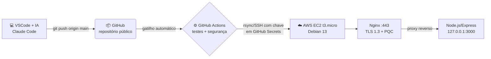

| Camada | Tecnologia |
|---|---|
| Nuvem | AWS EC2 `t3.micro` (Free Tier), região `us-east-2`, Elastic IP `18.189.71.156` |
| Sistema operacional | Debian 13 "Trixie" (AMI oficial) — OpenSSL 3.5 |
| Servidor Web | Nginx (HTTPS, redirecionamento HTTP→HTTPS, proxy reverso) |
| Certificado | Let's Encrypt para **endereço IP**, emitido pelo Certbot 5.9 (perfil *shortlived*, autorrenovação) |
| Aplicação | Node.js 20 + Express 5 + EJS |
| Repositório | GitHub (público) |
| CI/CD | GitHub Actions |
| IDE com IA | VSCode + Claude Code (equivalente ao Antigravity, permitido pelo escopo) |

### Estrutura do repositório

```
src/
  app.js                 # configuração do Express (Helmet, sessão, rotas, erros)
  server.js              # inicia o servidor em 127.0.0.1:3000
  middleware/auth.js     # requireAuth – bloqueia rotas internas (A01)
  routes/auth.js         # login / logout (A05, A07)
  routes/painel.js       # página interna protegida
  views/*.ejs            # telas (EJS escapa toda saída)
public/css/style.css
test/app.test.js         # testes automatizados de segurança
scripts/hash-password.js # gera o hash bcrypt da senha
infra/                   # TODA a configuração do servidor (infraestrutura como código)
  provision.sh           # script de provisionamento da VM
  nginx/                 # configuração do Nginx (TLS + PQC)
  fail2ban/jail.local    # 4 erros => 24h de banimento
  ssh/99-hardening.conf  # SSH só por chave
  systemd/               # serviço da aplicação com hardening
  sudoers/deploy         # permissões mínimas do usuário de deploy
.github/workflows/deploy.yml  # pipeline CI/CD
```

---

## ☁️ Eixo 1 — Infraestrutura (AWS Free Tier)

### Recursos criados

| Recurso | Nome / ID | Observação |
|---|---|---|
| Key Pair | `projeto-final-admin` | chave **ed25519**; a privada fica só no computador do aluno |
| Security Group | `projeto-final-sg` | entrada apenas **22, 80, 443** |
| Instância EC2 | `projeto-final-web` (`t3.micro`) | Debian 13, disco gp3 8 GB **criptografado**, IMDSv2 obrigatório |
| Elastic IP | `18.189.71.156` | IP público fixo |

Comandos utilizados (AWS CLI, perfil `iscb`):

```bash
# Chaves SSH (admin e deploy)
ssh-keygen -t ed25519 -f ~/.ssh/projeto-final-admin
ssh-keygen -t ed25519 -f ~/.ssh/projeto-final-deploy
aws ec2 import-key-pair --key-name projeto-final-admin --public-key-material fileb://~/.ssh/projeto-final-admin.pub

# Security Group: apenas as portas necessárias
aws ec2 create-security-group --group-name projeto-final-sg --description "SSH, HTTP e HTTPS" --vpc-id <vpc>
aws ec2 authorize-security-group-ingress --group-id <sg> --ip-permissions \
  'IpProtocol=tcp,FromPort=22,ToPort=22,IpRanges=[{CidrIp=0.0.0.0/0}]' \
  'IpProtocol=tcp,FromPort=80,ToPort=80,IpRanges=[{CidrIp=0.0.0.0/0}]' \
  'IpProtocol=tcp,FromPort=443,ToPort=443,IpRanges=[{CidrIp=0.0.0.0/0}]'

# Instância Debian 13 (Free Tier) com disco criptografado e IMDSv2
aws ec2 run-instances --image-id ami-03a782d5d8abd6fde --instance-type t3.micro \
  --key-name projeto-final-admin --security-group-ids <sg> \
  --block-device-mappings 'DeviceName=/dev/xvda,Ebs={VolumeSize=8,VolumeType=gp3,Encrypted=true}' \
  --metadata-options 'HttpTokens=required'

# IP público fixo
aws ec2 allocate-address --domain vpc
aws ec2 associate-address --instance-id <id> --allocation-id <eipalloc>
```

#### Evidências na console AWS

**Instância** `projeto-final-web`: executando, `t3.micro`, Elastic IP, IMDSv2 *Required*

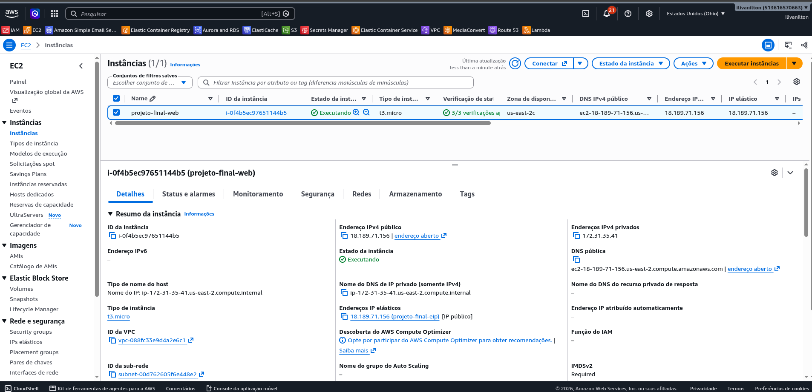

**Security Group** `projeto-final-sg`: entrada apenas nas portas 22, 80 e 443

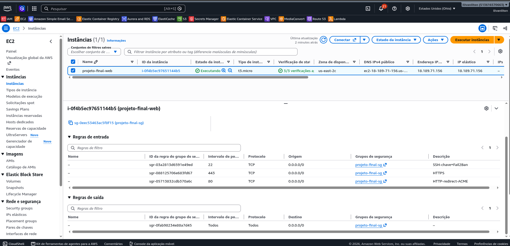

**Par de chaves** `projeto-final-admin` (ed25519)

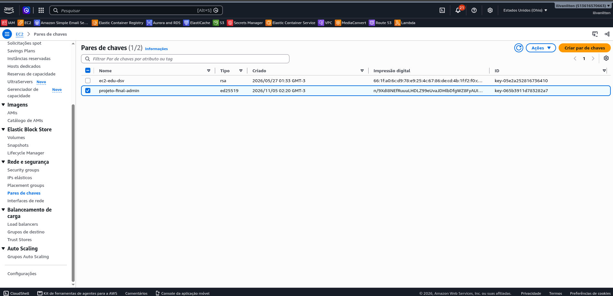

**Elastic IP** `18.189.71.156` associado à instância

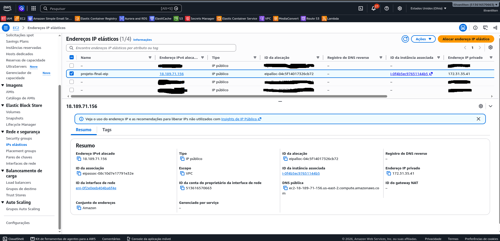

**Disco (EBS) criptografado**

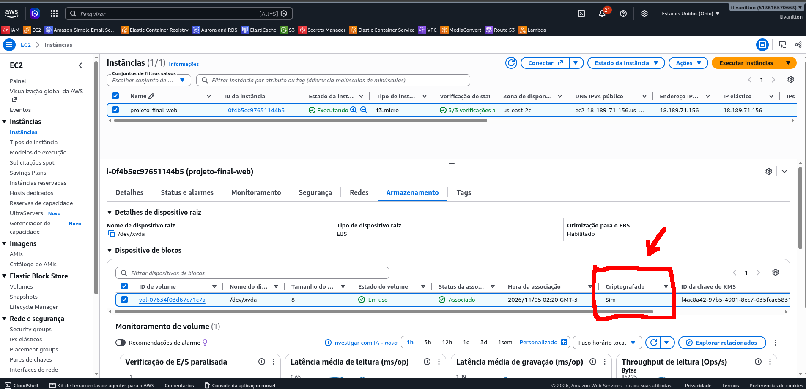

Em seguida, o servidor foi configurado com o script [infra/provision.sh](infra/provision.sh):

```bash
ssh -i ~/.ssh/projeto-final-admin admin@18.189.71.156 'sudo bash /tmp/infra/provision.sh 18.189.71.156'
```

> A porta 22 precisa ficar aberta para a internet porque os *runners* do GitHub Actions não têm IP fixo.
> Ela é protegida por **autenticação somente por chave** + **Fail2Ban**.

### 🛡️ Segurança da infraestrutura

| Requisito | Como foi atendido | Arquivo |
|---|---|---|
| SSH só por chave | `PasswordAuthentication no`, `KbdInteractiveAuthentication no`, `PermitRootLogin no`, `AuthenticationMethods publickey` | [infra/ssh/99-hardening.conf](infra/ssh/99-hardening.conf) |
| Fail2Ban na porta 22 | `maxretry = 4`, `bantime = 24h`, `mode = aggressive`, observando `sshd` **e** `sshd-session` (ver nota abaixo) | [infra/fail2ban/jail.local](infra/fail2ban/jail.local) |
| Least Privilege (rede) | Security Group + UFW liberando apenas 22/80/443 | [infra/provision.sh](infra/provision.sh) |
| Least Privilege (processos) | app roda como usuário `app` (sem shell), serviço systemd com `ProtectSystem=strict`, `NoNewPrivileges` | [infra/systemd/projeto-final.service](infra/systemd/projeto-final.service) |
| Deploy com privilégio mínimo | usuário `deploy` só pode executar `systemctl restart projeto-final` | [infra/sudoers/deploy](infra/sudoers/deploy) |
| HTTPS (Let's Encrypt para IP) | Certbot 5.9 (snap), `--ip-address`, perfil `shortlived`, autorrenovação via `snap.certbot.renew.timer` | [infra/provision.sh](infra/provision.sh) |
| Redirecionamento HTTP→HTTPS | `return 301 https://...` na porta 80 | [infra/nginx/projeto-final.conf](infra/nginx/projeto-final.conf) |
| TLS moderno | apenas TLS 1.2/1.3, cifras AEAD, HSTS, `server_tokens off` | [infra/nginx/projeto-final.conf](infra/nginx/projeto-final.conf) |
| **PQC** | `ssl_ecdh_curve X25519MLKEM768:...` (ML-KEM híbrido, OpenSSL 3.5) | [infra/nginx/projeto-final.conf](infra/nginx/projeto-final.conf) |
| Atualizações | `unattended-upgrades` ativo | [infra/provision.sh](infra/provision.sh) |

### ✅ Evidências

```text
$ ssh -o PubkeyAuthentication=no admin@18.189.71.156
admin@18.189.71.156: Permission denied (publickey).          # senha recusada

$ sudo fail2ban-client get sshd maxretry   ->  4
$ sudo fail2ban-client get sshd bantime    ->  86400          # 24 horas

# Teste real: 5 tentativas de login sem chave a partir de um IP de teste
[sshd] Found 172.31.35.41  (x4)
[sshd] Ban 172.31.35.41
$ sudo ufw status
Anywhere   REJECT   172.31.35.41   # by Fail2Ban after 4 attempts against sshd

$ curl -I http://18.189.71.156/
HTTP/1.1 301 Moved Permanently                                # redireciona para HTTPS

$ openssl s_client -connect 18.189.71.156:443 -groups X25519MLKEM768
Protocol: TLSv1.3
Negotiated TLS1.3 group: X25519MLKEM768                       # PQC ativo
issuer=C=US, O=Let's Encrypt, CN=YE2
Verify return code: 0 (ok)                                    # certificado confiável

$ sudo certbot renew --dry-run
Congratulations, all simulated renewals succeeded             # autorrenovação OK
```

> **🔎 Problema encontrado e corrigido durante a auditoria (Fail2Ban "cego"):**
> no Debian 13 / OpenSSH 10 as falhas de login são registradas pelo processo **`sshd-session`**, mas a
> configuração padrão do Debian (`/etc/fail2ban/jail.d/defaults-debian.conf`) só observa `_COMM=sshd`.
> Resultado: o Fail2Ban aparecia como ativo, porém contava **0 falhas** mesmo com tentativas reais no log.
> Além disso, com a senha desabilitada, uma tentativa sem chave gera apenas
> `Connection closed by authenticating user ... [preauth]`, que só é contada no **modo `aggressive`**
> (validado com `fail2ban-regex`: modo normal = 0 detecções, aggressive = 12).
> A correção ([infra/fail2ban/jail.local](infra/fail2ban/jail.local)) inclui `_COMM=sshd-session` e `mode = aggressive`,
> e foi validada com o teste de banimento acima.

**Testes externos exigidos:**

| Teste | Resultado |
|---|---|
| [SSL.org – SSL Certificate Checker](https://www.ssl.org/) | Certificate Trusted: **Yes** · sha384 / EC 256 bits · **Good signature · Good key** · TLS 1.2 e 1.3 |
| [DigiCert – TLS quantum readiness](https://www.digicert.com/pqc-checker) | **Pass**: TLS 1.3 habilitado + troca de chaves *quantum-safe* (ML-KEM) |

**SSL.org — SSL Certificate Checker**

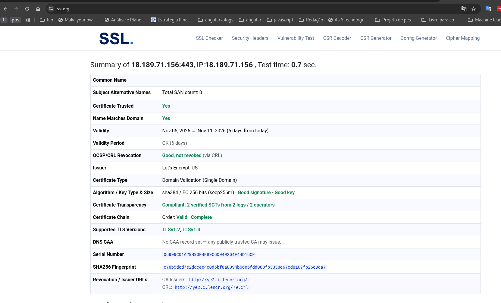

**DigiCert — TLS quantum readiness check**

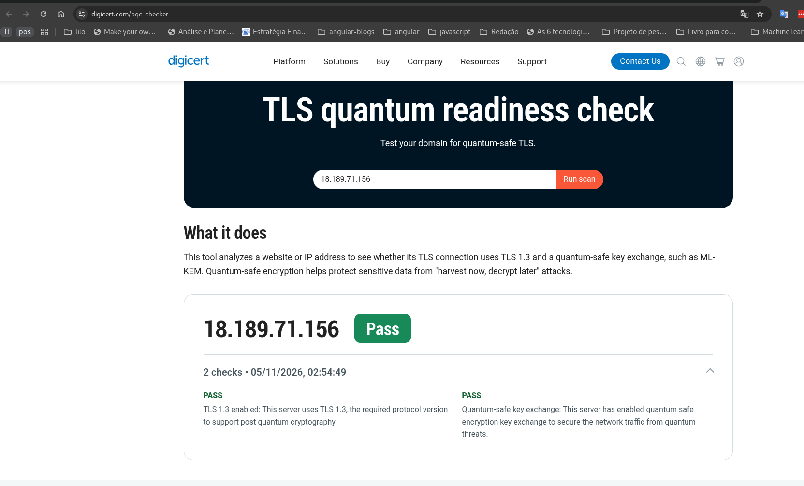

---

## 📦 Eixo 2 — Repositório

- Repositório **público** no GitHub; *commits/push* feitos via **chave SSH** (sem senha).
- Autenticação em duas etapas (**2FA**) ativada na conta.
- [.gitignore](.gitignore) bloqueia `.env`, chaves (`*.pem`, `id_*`, `*deploy_key*`), credenciais de nuvem e bancos locais.
- **Nenhuma credencial no código:** usuário, hash da senha e segredo da sessão ficam apenas em
  `/etc/projeto-final/app.env` no servidor (permissão `600`, dono `root`). O repositório tem só o modelo [.env.example](.env.example).
- A senha é armazenada **apenas como hash bcrypt**, gerado por [scripts/hash-password.js](scripts/hash-password.js).
- A pipeline executa o **gitleaks** em todo push, que falha se encontrar algum segredo.
- **Dependabot** ([.github/dependabot.yml](.github/dependabot.yml)) monitora dependências vulneráveis.

**2FA ativado na conta GitHub:**

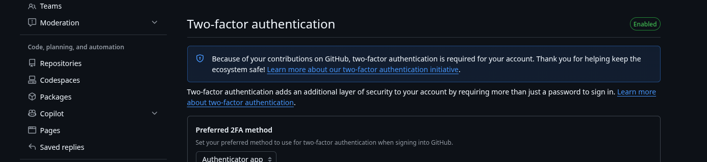

---

## 💻 Eixo 3 — Aplicação e OWASP Top 10:2025

Telas: **Login** (`/login`) → **Painel interno** (`/painel`, só autenticado) → botão **Sair** (`POST /logout`).

### As 3 vulnerabilidades mitigadas

#### 1️⃣ A01:2025 — Broken Access Control (Quebra de Controle de Acesso)

**Risco:** alguém acessar a página interna digitando a URL direto, sem fazer login.

**Como foi mitigado:**
- O middleware `requireAuth` verifica se há sessão válida; se não houver, redireciona para `/login`
  → [src/middleware/auth.js:8-16](src/middleware/auth.js#L8-L16)
- A rota `/painel` usa esse middleware → [src/routes/painel.js:10](src/routes/painel.js#L10)
- O logout **destrói a sessão no servidor** e apaga o cookie → [src/routes/auth.js:77-83](src/routes/auth.js#L77-L83)
- Páginas internas com `Cache-Control: no-store` (o botão "voltar" após o logout não mostra o conteúdo) → [src/middleware/auth.js:12](src/middleware/auth.js#L12)

**Como testar:** abra `https://18.189.71.156/painel` sem estar logado → você é enviado para o login.

#### 2️⃣ A05:2025 — Injection (Injeção)

**Risco:** o usuário digitar código (HTML/JavaScript, comandos) no formulário e ele ser executado.

**Como foi mitigado:**
- **Validação no servidor:** o usuário só aceita 3–32 caracteres `a-z A-Z 0-9 . _ -`, e a senha no máximo 128 caracteres; o resto é rejeitado
  → [src/routes/auth.js:30-36](src/routes/auth.js#L30-L36) e [src/routes/auth.js:51-53](src/routes/auth.js#L51-L53)
- **Escape da saída:** o EJS (`<%= %>`) converte `<` em `&lt;`, então um `<script>` digitado aparece como texto e nunca é executado
  → [src/views/login.ejs:20](src/views/login.ejs#L20)
- Reforço: *Content-Security-Policy* do Helmet bloqueia scripts inline → [src/app.js](src/app.js)

**Como testar:** digite `<script>alert(1)</script>` no usuário → aparece a mensagem de erro e nenhum alerta é executado.

#### 3️⃣ A07:2025 — Authentication Failures (Falhas de Autenticação)

**Risco:** senha vazada por estar guardada em texto puro, ou descoberta por tentativa e erro (força bruta).

**Como foi mitigado:**
- A senha é guardada **somente como hash bcrypt** e comparada com `bcrypt.compare` → [src/routes/auth.js:57](src/routes/auth.js#L57)
- **Limite de 5 tentativas a cada 15 minutos** por IP (`express-rate-limit`) → [src/routes/auth.js:15-26](src/routes/auth.js#L15-L26)
- **Mensagem genérica** "Usuário ou senha inválidos", que não revela qual dos dois está errado → [src/routes/auth.js:8](src/routes/auth.js#L8)
- Nova sessão após o login (`session.regenerate`), contra fixação de sessão → [src/routes/auth.js:65](src/routes/auth.js#L65)
- Cookie de sessão `HttpOnly`, `Secure`, `SameSite=Strict`, expirando em 30 min → [src/app.js](src/app.js)

**Como testar:** erre a senha 5 vezes → na 6ª tentativa aparece "Muitas tentativas de login. Aguarde 15 minutos".

### Testes automatizados

[test/app.test.js](test/app.test.js) valida as três mitigações (rodam localmente e na pipeline):

```bash
npm install
npm test
```

```
✔ A01 - painel sem login redireciona para /login
✔ A01 - login válido dá acesso ao painel e logout encerra a sessão
✔ A05 - entrada com HTML/script é rejeitada e exibida escapada
✔ A05 - tentativa de injeção no usuário não autentica
✔ A07 - senha errada retorna mensagem genérica
✔ A07 - bloqueia após 5 tentativas (força bruta)
✔ A07 - cookie de sessão é HttpOnly e SameSite=Strict
✔ Configuração - não expõe X-Powered-By e envia cabeçalhos de segurança
```

### Rodando localmente

```bash
cp .env.example .env
echo -n 'MinhaSenhaForte123' | npm run hash-password   # cole o resultado em APP_PASSWORD_HASH
openssl rand -hex 32                                   # cole em SESSION_SECRET
# para rodar sem HTTPS localmente, use NODE_ENV=development no .env
npm start   # http://127.0.0.1:3000
```

### Desenvolvimento assistido por IA

O código foi escrito e auditado no **VSCode com o Claude Code** (assistente de IA da Anthropic), usado como
ambiente equivalente ao Antigravity. A IA foi usada para:
- gerar o código da aplicação aplicando *Secure by Design*;
- escrever os testes automatizados de segurança;
- criar a infraestrutura como código (Nginx, Fail2Ban, SSH, systemd) e a pipeline;
- auditar o código (`npm audit`, gitleaks, lint) antes de cada entrega.

---

## 🔄 CI/CD — GitHub Actions

Arquivo: [.github/workflows/deploy.yml](.github/workflows/deploy.yml). É disparado a cada `git push origin main`.

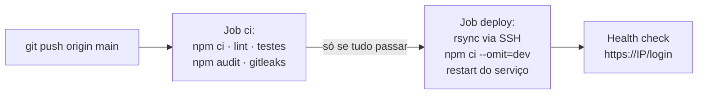

**Gerenciamento seguro das credenciais (GitHub Secrets):**

| Secret | Conteúdo |
|---|---|
| `SSH_PRIVATE_KEY` | chave privada **exclusiva de deploy** (ed25519), autorizada apenas para o usuário `deploy` |
| `SSH_HOST` | IP do servidor |
| `SSH_USER` | `deploy` |
| `SSH_KNOWN_HOSTS` | impressão digital do servidor (evita ataque *man-in-the-middle*, `StrictHostKeyChecking=yes`) |

Boas práticas na pipeline: `permissions: contents: read` (token com privilégio mínimo), deploy só ocorre se os
testes e as verificações de segurança passarem, a chave é apagada do runner ao final e nenhuma credencial aparece no `.yml`.

**Secrets cadastrados** (o valor nunca é exibido pelo GitHub):

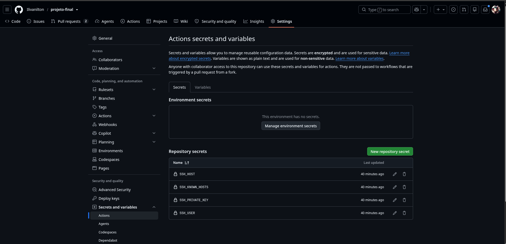

**Pipeline executada com sucesso** após `git push origin main` (job de testes → job de deploy):

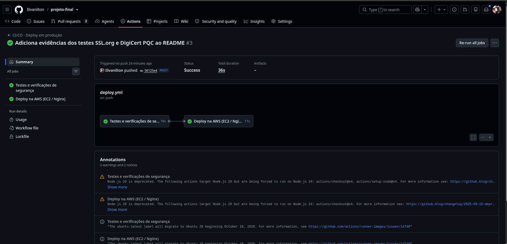

---

## ✅ Checklist final

- [x] Aplicação no ar e acessível por IP público — <https://18.189.71.156> (Eixo 1)
- [x] Nginx com HTTPS (Certbot/Let's Encrypt) e redirecionamento HTTP→HTTPS (Eixo 1)
- [x] Teste TLS: certificado confiável + PQC ativo (Eixo 1)
- [x] Acesso por chave SSH e Fail2Ban na porta 22 (4 erros / 24h) (Eixo 1)
- [x] Código em repositório público no GitHub, conta com SSH e 2FA (Eixo 2)
- [x] `.gitignore` configurado e nenhuma chave/senha exposta (gitleaks) (Eixo 2)
- [x] Login, página interna e logout, desenvolvidos com IA (VSCode + Claude Code) (Eixo 3)
- [x] README explica os 3 itens OWASP mitigados e onde estão no código (Eixo 3)
- [x] Deploy automatizado com GitHub Actions a cada `git push origin main` (CI/CD)
